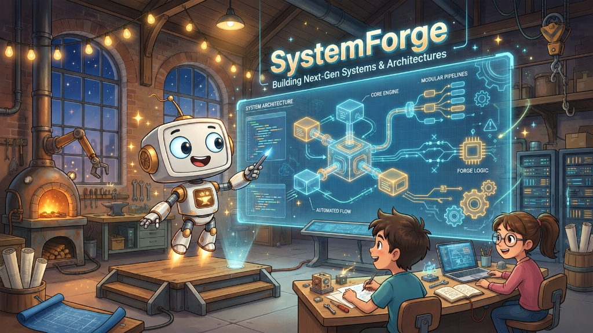
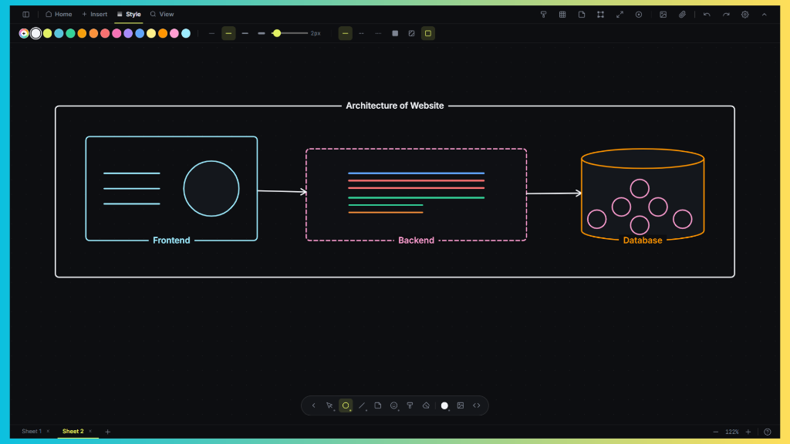

<p align="center">
  
</p>

# system-forge

> **A simple, fast whiteboard for sketching system architectures and taking notes.**

Ever tried sketching an architecture or system design and wished you had a clean whiteboard and notepad in one place? **system-forge** gives you a fast, distraction-free workspace where you can draw diagrams, connect components, and write notes side-by-side—with everything saved automatically to the cloud.

---

## ⭐ Example Diagrams Created with SystemForge!

> *From quick system sketches to full production architecture blueprints.*

<p align="center">
  
</p>

---

## 🚀 Key Features

* 🎨 **Infinite Whiteboard:** Draw rectangles, circles, databases, sticky notes, and connecting arrows.
* 📝 **Side-by-Side Notes:** Write markdown notes and documentation right next to your canvas.
* 📑 **Multiple Sheets:** Create and switch between multiple sheets (`Sheet 1`, `Sheet 2`) easily.
* ☁️ **Auto-Save:** Every shape, line, and note is automatically saved to MongoDB.
* ⚡ **Easy Setup:** One simple command to run the whole project (`npm run dev`).

---

## ⚡ Quick Start

### 1. Clone & Install
```bash
git clone <YOUR_GITHUB_REPO_URL>
cd system-forge
npm install
```

### 2. Add Database Connection
Copy `.env.example` to `.env`:
```bash
# Windows
Copy-Item .env.example .env

# Mac / Linux
cp .env.example .env
```
Open `.env` and paste your MongoDB connection URL:
```env
MONGODB_URI=mongodb+srv://<username>:<password>@cluster0.mongodb.net/architecture_workspace?retryWrites=true&w=majority
```

### 3. Start the App
```bash
npm run dev
```
Open **[http://localhost:5000](http://localhost:5000)** in your browser.

---

## ⌨️ Shortcuts

| Action | Shortcut |
| :--- | :--- |
| **Select / Move** | `V` |
| **Pan Canvas** | `H` or `Space + Drag` (or Middle Mouse) |
| **Rectangle** | `R` |
| **Diamond / Circle** | `D` / `O` |
| **Database Cylinder** | `C` |
| **Arrow / Line** | `A` / `L` |
| **Table / Sticky Note** | `G` / `S` |
| **Show / Hide Notes** | `Ctrl + H` |
| **Undo / Redo** | `Ctrl + Z` / `Ctrl + Y` |
| **Zoom In / Out** | `Ctrl + Wheel` or `+` / `-` |

---

## 🏗️ Project Structure

```
system-forge/
├── assets/
│   ├── banner.jpg        # Project cover image
│   └── app-preview.png   # Application UI screenshot
├── index.html            # Main canvas & UI layout
├── package.json          # Dependencies & start scripts
├── .env                  # MongoDB connection (private)
├── .env.example          # Sample env file
├── .gitignore            # Ignores node_modules & .env
│
├── backend/              # Node.js + Express API
│   └── src/
│       ├── config/db.js  # Database connection
│       ├── routes/       # API routes
│       └── server.js     # Backend server
│
└── frontend/             # Client assets
    ├── css/style.css     # Styling
    └── js/app.js         # Canvas drawing & tools
```

---

## 🛠️ Tech Stack

* **Frontend:** JavaScript, HTML5 Canvas, CSS
* **Backend:** Node.js, Express
* **Database:** MongoDB
